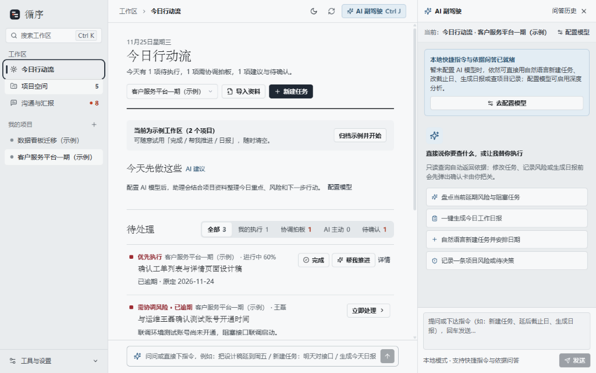
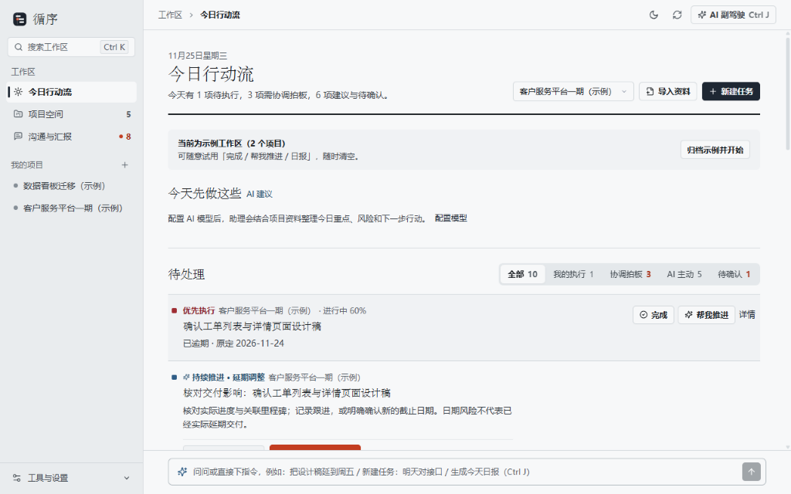
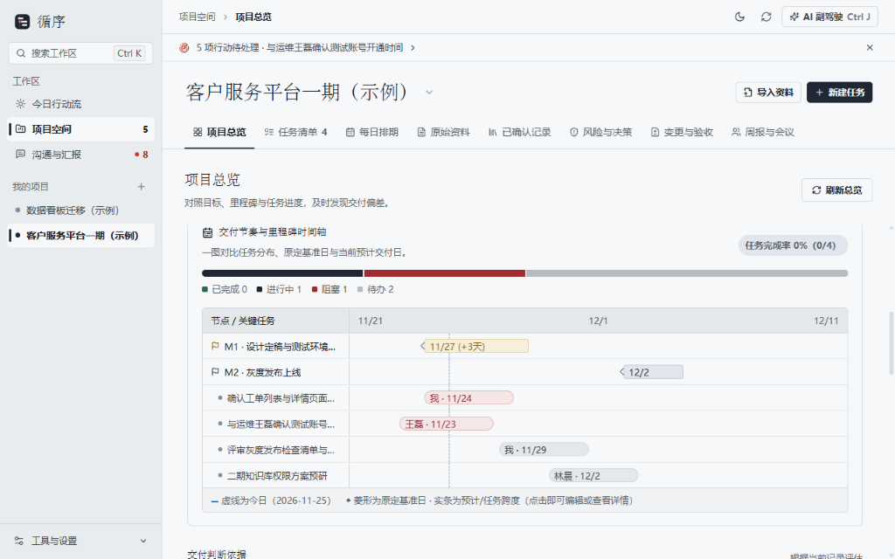
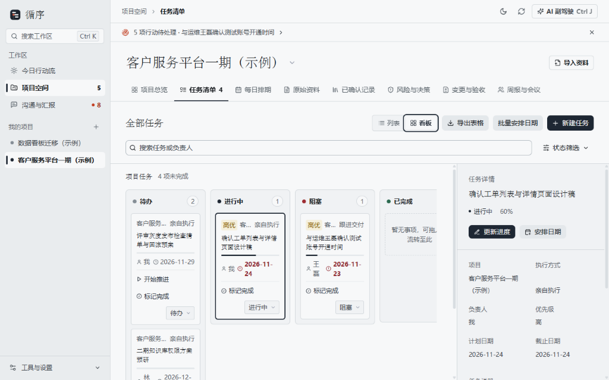

<div align="center">

# Cadence (循序)

**A Local-First AI Delivery Workbench Built for Project Managers**

*Every claim grounded in source files · Zero cloud account or telemetry · Human confirmation before every write*

<p>
  <a href="README.md">简体中文</a> ·
  <a href="README_EN.md"><strong>English</strong></a> ·
  <a href="https://github.com/potatocheng/project-assistant/releases">Releases</a> ·
  <a href="https://potatocheng.github.io/project-assistant/">Landing Page</a> ·
  <a href="PRIVACY.md">Privacy Whitepaper (CN)</a>
</p>

<p>
  <a href="LICENSE"></a>
  <a href="https://github.com/potatocheng/project-assistant/releases"></a>
  
  
</p>

</div>

> **Language note**: The desktop UI and sample templates are currently in **Simplified Chinese (简体中文)**, designed around Chinese PM workflows (Excel/Word/PPT/PDF/WeChat/Feishu). English UI localization (i18n) is on the roadmap — PRs are very welcome!

Built with **Tauri 2 + Rust + React 19 + SQLite (`jieba` + `sqlite-vec`)**. Cadence runs 100% locally on your machine with **no SaaS account, no subscription, and no telemetry**. Drop messy meeting notes, Excel schedules, slide decks, PDFs, emails, or pasted chat logs into one local workspace — Cadence indexes every passage with exact source coordinates, tracks milestones & blockers, and pairs you with a **human-in-the-loop AI Copilot** powered by your own OpenAI-compatible API or **100% offline Ollama**.

<p align="center">
  
</p>

---

## Screenshots

<table>
  <tr>
    <td width="50%">
      
      <p align="center"><strong>Today Action Stream</strong>: Overdue work, blockers, and proactive alerts in one view</p>
    </td>
    <td width="50%">
      
      <p align="center"><strong>Milestone Gantt Timeline</strong>: Baseline vs. current forecast variance at a glance</p>
    </td>
  </tr>
  <tr>
    <td width="50%">
      
      <p align="center"><strong>4-Column Kanban + Detail Drawer</strong>: Todo / In Progress / Blocked / Done</p>
    </td>
    <td width="50%">
      
      <p align="center"><strong>AI Copilot (⌘J / Ctrl+J)</strong>: Reads local evidence; writes always require explicit confirmation</p>
    </td>
  </tr>
</table>

---

## Why Cadence?

Most "AI project tools" force two bad compromises: migrating your whole team into another cloud SaaS, or pasting confidential client contracts into a web chat box that hallucinates dates.

Cadence takes a different architectural stance:

1. **Zero team migration required**: Drag & drop `.xlsx`, `.docx`, `.pptx` (including speaker notes), `.pdf`, `.csv`, `.eml`, `.md`, `.txt`, or raw pasted chat logs (up to 50 files per batch).
2. **Exact source traceability**: Every extracted memory, risk, decision, and AI answer points back to its exact document coordinates (sheet/row, slide number, page/paragraph).
3. **Human-in-the-loop Agent boundary**: The AI Copilot (`⌘J` / `Ctrl+J`) executes read-only queries automatically, but **every mutation** (creating tasks, shifting due dates, logging risks, generating reports) renders an interactive confirmation card that only commits after you click confirm.
4. **Audience-aware reporting without fabrication**: Turn real task progress into Executive Summary, Team Sync, or Client-Facing reports and export as rich text, native `.docx`, 2x high-DPI `.png` summary cards, or PDF.
5. **Hard privacy & offline boundary**:
   - All project data stays in your local SQLite workspace.
   - API keys live strictly in `secrets/` (optional AES-256-GCM protection via macOS Keychain / Windows Credential Manager) and **never enter backups or SQLite**.
   - Zero bytes leave your machine until you explicitly opt in (`remoteConsent`), or run **100% air-gapped with local Ollama**.

---

## Technical Architecture

- **Desktop Host**: Tauri 2 (`src-tauri/`) with strict CSP & scoped capabilities.
- **Core Engine (`crates/core/`)**: Pure Rust library + CLI host (`pm-host`) handling:
  - Multi-format native parsing (`parse.rs`) & native `.docx` export (`docx_export.rs`).
  - Local SQLite persistence with versioned migrations, consistent snapshot backups, and AES-256-GCM + scrypt encrypted `.pabackup` archives (`db.rs`, `backup.rs`).
  - Hybrid memory retrieval (`jieba` tokenization + `sqlite-vec` vector search), habit learning, and sleep-time conflict auditing (`memory_query.rs`, `habits.rs`, `memory_audit.rs`), benchmarked on QASPER (`docs/benchmarks-and-dev.md`).
  - Proactive health checks, daily planning engine, and optional scoped Feishu personal assistant (`proactive.rs`, `feishu/`).
- **Frontend (`src/`)**: React 19 + TypeScript + Vite + Ledger design system, featuring a built-in zero-API-key sample workspace so anyone can explore the full workflow in 3 seconds.

---

## Quick Start

### Option 1: Download Prebuilt Desktop Installer
Grab the latest Windows (`.exe` NSIS) or macOS Apple Silicon (`.dmg`) installer from **[GitHub Releases](https://github.com/potatocheng/project-assistant/releases)** (with `SHA256SUMS.txt`).

> **Note on unsigned open-source builds**:
> - **Windows**: On Microsoft Defender SmartScreen, click **More info → Run anyway**.
> - **macOS**: Right-click the app and choose **Open**, or run `xattr -cr /Applications/循序.app` if Gatekeeper blocks first launch.

### Option 2: Build from Source

Prerequisites: Node.js 22+, Rust toolchain pinned in [`rust-toolchain.toml`](rust-toolchain.toml), and standard Tauri 2 OS prerequisites.

```bash
git clone https://github.com/potatocheng/project-assistant.git
cd project-assistant
npm ci

# Run desktop app in dev mode
npm run desktop:dev

# Or build native installer locally
npm run desktop:build
```

---

## Documentation & Community

- **Contributing**: [CONTRIBUTING.md](CONTRIBUTING.md)
- **Privacy & Security**: [PRIVACY.md](PRIVACY.md) · [SECURITY.md](SECURITY.md)
- **Changelog**: [CHANGELOG.md](CHANGELOG.md)
- **Dev & Memory Benchmarks**: [docs/benchmarks-and-dev.md](docs/benchmarks-and-dev.md)
- **Signed Release & Rollback Guide**: [docs/desktop-release.md](docs/desktop-release.md)
- **License**: [MIT](LICENSE)
