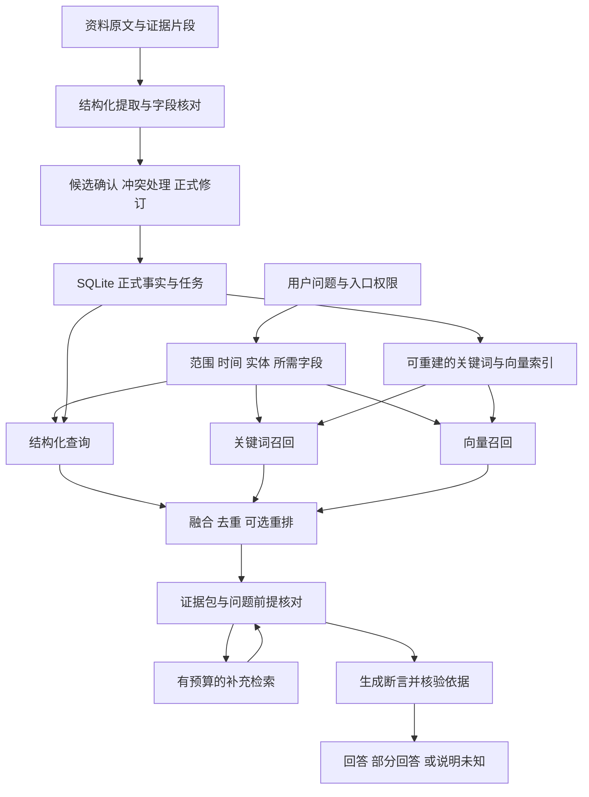

# 项目记忆系统优化方案

调研日期：2026年10月20日。方案基于当前 Rust、Tauri、SQLite 架构，以及已完成的离线检索和真实 DeepSeek 评估。

公开数据完整链路实测后的近期实施设计见[记忆提取与组织优化设计](memory-extraction-recovery-design.md)：优先解决提取预算、组织字段分级校验和批次恢复，再隔离评估回答与检索的改善。下文保留整体架构和开源方案参考。

## 推荐方案

当前先采用**结构化事实查询、关键词全文匹配、查询改写、受控补查与证据核验**，完成无向量方案的能力和成本评估。后续以组织后的正式事实、任务、关系及证据为单位建立向量索引。SQLite 保存正式记录与修订，搜索索引作为可以重建的派生数据。

实施顺序：

1. 统一桌面与飞书的检索核心，修正查询路由、上下文截断和未经证实的因果结论。
2. 实施常用术语归一化、字段相关性排序，以及依据不足时的一次模型查询改写；两个入口复用补查和核验流程。
3. 对比无向量方案的召回、证据支持、延迟与成本，完善实体、字段、关系和时间组织。
4. 在组织后的记录上实验 embedding 与混合检索；语义重排和更多搜索轮次分别通过对照决定。

第一阶段实现与实测见[无向量优化报告](memory-nonvector-evaluation-report.md)。下文的向量模型和索引是后续阶段的设计候选。

### 当前问题与优先级

| 现有证据 | 说明 | 对应改进 |
|---|---|---|
| 真实问答中，桌面关键事实及标准引用命中24/29，飞书23/29 | 尚有已有事实无法回答的问题；这两项指标没有覆盖回答中的全部断言 | 混合检索及逐断言核验 |
| 离线强语义改写题，飞书与桌面本地引用均为0/5；桌面模型候选覆盖4/5 | 词面检索不足，入口的候选筛选也不同 | 共享检索服务、语义召回 |
| 逐题审阅发现3处未经充分支持的因果或问题前提 | 合法引用仍可能被组合成错误结论 | 前提核对、关系类型、断言与证据对应 |
| 提取命中18/18项必要事实、24/24项任务字段 | 小型合成样本上的覆盖较好；新增候选的全量精确率尚未标注 | 扩展提取标注，保留现有提取主流程 |

以上结果分别见[真实模型报告](memory-live-evaluation-report.md)和[离线能力报告](memory-evaluation-report.md)。两个评估工作区的记忆 ID、时间戳及截断条件存在差异，跨报告变化需要结合逐题候选分析。

## 立党观点与本项目的对应关系

立党在2025年7月19日的原帖中主张：领域问题可以转成结构化数据，由 Agent 调用程序和 API 分步处理，并使用长期记忆框架建立合理索引；他批评缺少组织和设计、直接将大量文档送入向量库进行高成本查询的做法。[原帖](https://x.com/lidangzzz/status/1946329285490340159)

2026年8月18日的另一条原帖批评了关于 Agent 无需 memory、工具调用必须极简、上下文无需压缩的主张。这是他对相关理念的评价。具体项目的实现需要另查代码与文档。[原帖](https://x.com/lidangzzz/status/2089591788499529916)

他的 Goal-Driven 项目明确提出目标、可检验的完成条件和对结果的独立检查。对记忆系统，可以借鉴为“找到所需证据才回答、依据验收标准评价改进”。[Goal-Driven 官方仓库](https://github.com/lidangzzz/goal-driven)

本项目据此采用以下设计判断：

- 负责人、截止时间、任务状态、依赖优先查询正式结构化记录。
- 原文、正式事实、当前工作摘要各自保留用途和来源。
- embedding 负责弥补语义召回缺口，重排负责候选排序；两者的收益分别测量。
- 多轮搜索围绕缺失的证据执行，并设置停止条件和成本上限。
- 生成后的核验与生成分开执行；人工标注负责最终评估标准。

这些具体选型来自本项目的实测和工程约束，原帖没有给出必须使用某种 embedding、重排模型或向量数据库的技术清单。

## 开源方案调研

重点参考有公开实现、清晰文档和完整使用流程的项目。框架的使用经验有助于选择机制，具体模型和适配器仍需在本项目验证。

| 项目 | 官方方案中值得借鉴的机制 | 本项目采用方式 |
|---|---|---|
| Haystack | 多检索器输出经 DocumentJoiner 合并，可选 RRF；Cross Encoder 位于召回之后，对有限候选重排 | 在 Rust 中实现检索管线与统一候选格式。[合并文档](https://docs.haystack.deepset.ai/docs/documentjoiner)、[重排文档](https://docs.haystack.deepset.ai/docs/sentencetransformerssimilarityranker) |
| Qdrant | 稠密与稀疏检索、结果融合、分阶段查询 | 借鉴融合和分阶段检索；后端接口预留向量服务适配能力。[官方混合查询文档](https://qdrant.tech/documentation/search/hybrid-queries/) |
| Mem0 OSS | 当前公开代码在作用域内获取既有记忆，再执行 additive extraction，包含去重、持久化和历史记录步骤 | 借鉴作用域、提取上下文与生命周期分层；业务事实继续遵循现有确认、冲突和修订规则。[官方实现](https://github.com/mem0ai/mem0/blob/main/mem0/memory/main.py) |
| Letta | 常驻上下文的 memory blocks，有容量限制，并支持只读块 | 将明确偏好和经过新鲜度校验的项目简报组织为小型工作上下文。[官方 memory blocks 文档](https://docs.letta.com/v1-sdk/memory/memory-blocks) |
| Graphiti | 事实的有效时间、记录时间、历史与原始来源；语义、关键词和关系遍历结合 | 先在 SQLite 中补充事实时间与带来源的关系；沿用已有任务依赖。[官方仓库](https://github.com/getzep/graphiti) |
| RAGFlow | 多路召回与重排、可查看的切块与引用、复杂问题多步检索 | 借鉴检索轨迹和原文查看体验。其完整服务部署涉及多个组件，采用机制需适配桌面资源预算。[官方仓库](https://github.com/infiniflow/ragflow) |
| Google LangExtract | 提取结果精确定位原文；分块与多次提取用于提高长文覆盖 | 为现有逐字引用补充位置与字段依据；仅对需要补查的片段增加提取轮次。[官方仓库](https://github.com/google/langextract) |

Mem0 表中描述的是调研时的开源代码，不能将托管服务功能或旧版本流程直接套用。Graphiti 的自动事实失效也需要适配本产品的人工确认规则。关系图中的连接本身不证明因果。

## 目标架构

两个入口共享检索、版本和证据校验逻辑，并分别配置可见记录类型。飞书沿用项目范围、资料访问许可及现有记录开放边界；个人偏好只供桌面表达使用。

原文是来源记录，正式事实是经过产品规则接纳的业务状态，简报是派生视图。查询时携带这三种身份，便于回答区分“当前记录”“资料中的说法”和“摘要中的提示”。

## 正式事实与时间设计

复用当前 memories、revisions、tasks、依赖、里程碑和证据表。新增的事实属性作为修订的扩展信息，逐步覆盖需要精确查询的内容。

| 信息 | 建议字段或表示 | 用途 |
|---|---|---|
| 实体与属性 | subjectId、predicate、object/value | 识别同一任务、接口、验收事项及其负责人、范围或参数 |
| 表达性质 | actual、planned、proposed、conditional；polarity | 区分已发生、计划、建议、条件及否定 |
| 生效时间 | validFrom、validTo，可为空 | 表示业务事实在哪段时间成立 |
| 系统记录时间 | recordedAt、revisionId | 表示系统何时得到并接纳此版本 |
| 来源 | sourceId、sourceVersion、segmentId、quote、位置 | 从每项事实返回相应原文；人工输入沿用人工记录身份 |
| 生命周期 | 沿用现有当前版本、归档、待确认冲突和修订关系 | 决定能否参加当前问答 |
| 明确关系 | depends_on、blocks、caused_by、supersedes 等 | 为依赖查询和原因问题提供有类型的依据 |

采用 Graphiti 的时间与来源组织思路，实际表结构在 Rust 核心中实现。历史记录需要同时区分“当时实际生效的内容”和“截至当时系统已经知道的内容”。业务时间未知时保留未知，记录时间不能代替生效时间。[Graphiti 时间与来源设计](https://github.com/getzep/graphiti)

实体映射先使用项目内稳定 ID、人工别名和明确引用。对于“张工”等有歧义称呼保留候选，避免错误合并。结构化任务直接提供已有负责人、状态等字段；泛化事实表不再维护一份可独立修改的任务状态。

关系需要记录支持它的来源、修订和表达性质。原文明示或人工确认的原因可以作为原因依据；模型推测保存为待确认建议。任务依赖链可以支持条件性的影响分析，实际延期及其原因仍需相应事实。

旧记忆先保留正文和修订。查询和索引能够使用旧格式；结构化补充在后续确认或有针对性的整理中完成。

## 统一检索与查询路由

### 查询计划

在核心新增共享的 MemoryQueryService。输入至少包含入口、项目范围、当前或历史时间模式、问题、可见记录类型、预算和工作区版本。

查询计划识别实体、所需字段及需要核对的前提。常见字段和明确实体先通过本地规则处理；复杂拆问可以在后续受控搜索阶段交给模型。用户问题中的“已经延期”等说法标记为待核对前提。

| 问法 | 查询方法 |
|---|---|
| 某验收由谁负责、哪天截止 | 定位实体，读取正式任务字段和对应版本；存在歧义时列出候选 |
| 批量导出安排在哪个阶段 | 同时检索需求、阶段和任务，结合实体与所需属性排序 |
| 没网能不能改手机内容 | 关键词与语义双路召回，再核对否定与条件 |
| 上线为什么延期 | 分别核对延期是否发生、前置依赖、已记录阻塞和明确原因 |
| 总结当前进展 | 按任务、决策、阻塞等类型分配证据预算，并显示覆盖范围 |

当前桌面路由受“安排”“卡”等宽泛关键词影响，模型候选也会受本地回答引用加权影响。改为多路查询和字段相关性排序，减少单个词将问题固定到一种记录类型的情况。

### 混合召回

所有检索分支先按项目、可见类型、修订、归档和冲突状态筛选。向量分支在合格数据集内取 Top K，避免先全库取少量结果再过滤造成漏召回。

首轮实验参数如下，均为本项目调参起点：

- 关键词候选40条，向量候选40条，结构化及明确关系候选最多20条。
- 正式字段的唯一精确匹配直接进入证据包；其他候选经 RRF 融合，保留最多60条。
- 启用重排时处理融合后的候选；上下文按问题需要选择约8至12项证据，并设 token 上限。
- 同一修订的重叠片段合并，同一事实的不同来源保留为补充依据。
- 时间作为相关问题的条件或次级排序依据；零词面得分时由语义检索补充。

RRF 按各列表中的名次合并，适合融合 BM25 与向量这类分数尺度不同的结果。采用从1开始的名次，试验 `sum(weight / (k + rank))`，初始 k=60，再在开发集校准。此处参数是本项目选择，各框架的默认值可能不同。[Haystack 融合机制](https://docs.haystack.deepset.ai/docs/documentjoiner)、[Qdrant 混合查询](https://qdrant.tech/documentation/search/hybrid-queries/)

模型候选从完整合格语料的检索结果产生。桌面当前80条记忆的上下文上限不再充当语义检索的预筛选池。类型预算随问题分配，例如专门问决策时允许更多决策证据。

查询返回检索状态，例如 complete、indexing、limit_reached、provider_unavailable。达到容量或索引尚未完成时，回答说明检索覆盖不足；“未找到”只表示本次可见范围内没有找到。

## 后续向量阶段的模型与索引候选

### 推理运行时与模型

首选验证 FastEmbed Rust 和 ONNX Runtime。它提供本地 embedding、重排以及相应模型列表，可以接入 Rust 工作线程。[FastEmbed Rust 官方仓库](https://github.com/Anush008/fastembed-rs)

| 能力 | 首轮候选 | 选择方法 |
|---|---|---|
| embedding | multilingual-e5-small | 先测桌面资源占用和中英改写召回，作为较小模型的基线 |
| embedding 对照 | BGE-M3 | 在相同题集测质量与资源成本，决定是否提供较大模型选项 |
| 重排 | bge-reranker-base、bge-reranker-v2-m3 | 比较中英问题上的上下文证据覆盖、延迟和内存 |

multilingual-e5-small 输出384维向量，输入最多512 token，检索时包括非英语内容也需正确使用 query 与 passage 前缀。因此索引按模型 tokenizer 切片，保留标题、必要上下文及原文映射。当前提取用的6000字符批次不能直接当作 embedding 输入。[E5 官方模型卡](https://huggingface.co/intfloat/multilingual-e5-small)

重排模型接收问题和候选文本，输出相关性分数。其分数用于排序，不表示事实为真的概率，也不能直接证明因果关系。[BGE 重排官方模型卡](https://huggingface.co/BAAI/bge-reranker-v2-m3)

正式选择前固定运行时版本、ONNX 文件、tokenizer、模型版本、许可证和校验和，测 Windows 打包、CPU 冷启动、峰值内存、线程占用和取消。模型下载明确展示大小与进度，完成后支持离线使用。远程 embedding 或重排作为独立提供方，沿用资料访问许可和私有凭据配置。

### 向量存储

第一版可以将向量作为 SQLite BLOB 保存，Rust 在经过范围筛选的向量集合上执行精确余弦搜索。以1万条384维 float32 向量估算，纯向量约14.6 MiB；元数据、缓存、模型权重和推理内存另计。该实现便于测量正确性和建立性能基线。

同时预留 VectorIndex 接口，在数据规模和实测延迟需要时比较其他后端：

- sqlite-vec 提供轻量 SQLite 向量扩展和 Rust 接入，但官方仍标注 pre-v1，需要固定版本并验证升级与打包。[官方仓库](https://github.com/asg017/sqlite-vec)
- Qdrant 可作为需要更大规模索引和独立服务时的适配候选。选择时重新比较部署形态、范围过滤和运维成本。[官方查询能力](https://qdrant.tech/documentation/search/hybrid-queries/)

### 索引生命周期

正式数据变更与索引待办在同一 SQLite 事务登记。工作线程读取版本化快照后计算向量，提交前核对工作区 epoch、实体修订和内容哈希。推理与大规模向量计算在数据库 actor 之外完成。

索引键包含工作区、项目、实体、修订、片段位置、内容哈希、切片器版本及模型版本。查询返回结果前再次验证当前可见性，修订或删除后的旧向量立即失去资格，后台随后清理物理数据。

模型切换时建立独立索引代次，完成后切换；不同模型的向量不能混用。备份以正式资料和修订为准，向量缓存可重建。还原或工作区切换递增 epoch，拒绝旧后台任务的迟到提交。索引未就绪时继续提供可用的结构化与关键词查询，并说明覆盖状态。

embedding、重排和补查分别设置开关。重排超时可以使用融合后的顺序继续核验证据；embedding 不可用时返回可用分支的结果及检索状态。任何降级都继续遵守范围、当前版本和证据要求。新增回答协议使用版本号，由入口适配层转换成公共响应；数据库增量迁移沿用现有备份兼容流程。

## 提取准确率优化

保留当前分批、重叠、输出 schema、逐字引用和候选确认流程，补充以下能力：

1. **字段分别绑定证据。** 正文、负责人、日期、状态和数值分别关联片段，保存原始表达与允许的标准化结果。引用中出现某个人名，只能证明该名字存在，角色仍需语义核对。
2. **精确原文位置。** 在 segmentId 与 quote 外记录源版本、正文哈希、起止位置及单位，例如 UTF-8 字节偏移；跨批重叠片段按原文位置去重。
3. **保留表达条件。** 标注否定、计划、建议、条件、历史与更正；覆盖率、实际完成率等数值记录所属指标。
4. **针对性补查。** 长文跨段指代、表格字段或相互冲突的表述可触发额外提取；多轮结果继续逐项核对与去重。
5. **完整标注新增候选。** 除必要事实召回外，人工评审模型新增的全部事实，记录误提、遗漏和字段关系错误。

原文定位和按需增加提取轮次参考 LangExtract。引用位置能支持追溯，提取内容是否准确还要核对语义。[LangExtract 官方方案](https://github.com/google/langextract)

## 回答与证据核验

### 输出原子断言

生成内部结构包含：回答状态、claims、每项 claim 的依据 ID、事实或条件推导类别、尚缺信息。公共界面据此展示正文、引用和未知项。

核验分两层：

- 确定性校验引用是否属于本次范围、修订是否有效、数值与字段是否来自指定记录、关系类型是否允许相应结论。
- 对复杂回答逐项核对证据是否支持断言，包括主语、时间、否定、条件和问题前提。可以使用独立的一次模型请求辅助检查，争议项在评估中由人工复核。

模型核验失败后，最多在剩余预算内重写一次。仍缺证据时输出已知部分和未知项。模型核验本身也会出错，其改善需要在冻结题集上测量。

### 已知错误的目标行为

| 问题 | 应有回答行为 |
|---|---|
| 上线为什么已经延期 | 先核对实际延期记录。只有前置依赖和阻塞时，说明已知阻塞及潜在影响，保留实际延期状态为未知 |
| 商务确认为什么没完成 | 引用直接说明商务确认条件的记录。供应商账单与客户差额没有明确关联时，分别陈述各自事实 |
| 开发完成是不是代表验收完成 | 分别读取开发状态与验收状态，保留两者差异 |
| 某负责人或日期未知 | 返回未记录或存在冲突，并提供相关依据供核对 |

正式任务、人工纠正和自动接纳的记忆保留其来源身份。人工记录没有原文时可以引用该正式记录，界面显示人工记录来源；回答不虚构原文摘录。

## 工作上下文与多轮搜索

### 小型工作上下文

参考 Letta 的 memory blocks，为桌面提供有容量限制的工作上下文：明确表达偏好、当前项目范围、必要的实体说明，以及与问题相关的简报条目。[Letta 官方说明](https://docs.letta.com/v1-sdk/memory/memory-blocks)

复用已有简报指纹和过期状态。简报条目进入回答依据前回查正式记录，版本变化后刷新或省略。偏好控制表达方式，项目事实仍从正式记录取证。生成的回答、模型推测和临时搜索计划不自动成为正式记忆。

### 受控的只读搜索

复杂问题初次检索后，检查哪些所需字段或证据仍缺失；只对这些缺口补查。工具包括 search_memory、get_record、read_source_excerpt、get_task 和 trace_dependencies。

工具运行在 Rust 受限接口内，统一检查项目、可见记录类型、返回大小与版本。读取原文需要明确记录身份及相应许可，原文内容保留来源资料标签。搜索原文得到的新说法需要经过既有确认流程才能改变正式业务状态。

首轮预算建议：初次本地检索后最多2次补充检索决策、总计最多6次只读工具调用；包含最终生成与可选核验在内最多4次生成模型请求。重写占用同一额度。另设累计输入输出 token、单次与总耗时上限，预估用量先占预算，实际 usage 返回后结算。具体数值通过后续评估确定。

停止条件是证据足够、没有新的可用检索方向，或预算耗尽。预算耗尽时返回已有证据支持的部分，并说明尚未确认的事项。普通字段查询走直接查询和单次回答路径。

## 实施阶段与代码落点

| 阶段 | 交付内容 | 主要代码位置 | 完成条件 |
|---|---|---|---|
| P0 无向量实现 | 共享当前记忆检索、字段查询、常用术语、一次改写补查、因果核验和统一预算 | search.rs、memory_query.rs、question_flow.rs、qa.rs、assistant_qa.rs | 开发回归、隔离合成资料的真实模型测试，记录收益及剩余问题 |
| P1 组织与评估完善 | 实体与属性、明确关系、时间、字段证据、全量提取标注及独立问题集 | ai.rs、memory.rs、memory_workbench.rs、评估夹具 | 明确索引单位与事实来源；具备可比较的无向量基线 |
| P2 有组织的语义索引 | EmbeddingProvider、VectorIndex、版本化索引待办、本地模型与混合检索 | 新增 embedding/index 模块；db.rs、lib.rs、settings.rs、backup.rs | 对未见题有稳定增益，更新、取消和还原后索引一致 |
| P3 排序与复杂查询增强 | RerankProvider、工作上下文、更多受控工具和补查轮次 | 查询模块、memory_workbench.rs、lib.rs、Tauri 允许列表 | 分别证明排序或复杂题收益，满足成本、范围和版本要求 |

每阶段可独立交付。P0 复用现有正式记录；完整关系属性与双时间查询逐步增加。向量阶段先测无重排的混合检索，再比较重排和更多工具轮次。

## 验收与实验设计

当前35题已用于诊断和修正，作为开发回归集保留。下一轮准备独立的冻结题集，按项目或事实组划分，避免同一事实的近似问法分散到开发集与测试集。

建议从100道未见问题起步：20道精确字段、20道语义改写与中英混合、15道长文与多依据、20道时间与否定条件、15道无答案与错误前提、10道作用域与资料内指令干扰。另用确定性工程用例覆盖大量范围、修订和索引竞态组合。

提取另建按资料标注的事实集，包含全部可提取事实及所有实际生成候选。两位评审分别核对争议或高风险样本；模型评分作为辅助。真实业务资料进入模型评估时沿用资料访问许可。

### 对照组合

| 组合 | 目的 |
|---|---|
| 当前版本 | 保存基线 |
| P0 校正后 | 分离路由、截断与证据核验的收益 |
| 仅关键词、仅向量、两者融合 | 测量各召回路径的贡献 |
| 融合后增加重排 | 测量前8或12项证据的排序收益 |
| 相同检索增加受控补查 | 测量复杂问题的额外收益与模型用量 |

固定资料、标准记忆、ID、时间戳、模型与提示配置，记录每路候选、融合名次、重排名次、送入模型的证据、最终断言与引用。检索从人工标准记忆起步，端到端从实际提取结果起步，分别报告。

### 建议初始门槛

以下为本项目的试验目标，需要在冻结题集上验收：

| 指标 | 初始门槛 |
|---|---|
| 项目与入口范围、当前版本、冲突过滤、过期结果 | 工程用例中违规0条，失败阻止发布 |
| 已发现的3处前提及因果问题 | 逐项修复，禁止将缺乏依据的原因当成确定事实 |
| 有答案题全部必要证据进入候选前60 | ≥95%，同时报告题数和各类别 |
| 全部必要证据进入最终上下文前8或12 | ≥90%，固定 K 后比较；精确字段查询单列 |
| 回答关键断言的证据支持率 | 争取≥98%，同时报告漏答、错误前提及错误拒答 |
| 提取质量 | 全量原子事实 precision 和 recall 分别争取≥95%；负责人、日期、状态另列 |
| 重排默认开启 | 未见题集的上下文覆盖稳定改善，且满足本机延迟和内存预算 |
| 普通问题成本 | 默认不进入补查循环；记录调用数、实际 token、P50/P95与冷启动 |
| 复杂问题成本 | 工具、生成请求、token、耗时均在配置预算内；报告每道成功回答的成本 |

固定模型重复3次用于观察波动，按问题报告稳定性；重复运行不增加独立样本数。小样本中的零错误仅代表观察结果。扩展到1000、1万和更大规模索引时分别测正确性、冷启动、后台构建与查询耗时。

## 首先实施的范围

首先完成 P0 无向量实现与测试，并据结果推进 P1 的信息组织。在此基线上接入有组织的向量索引，单独度量它增加的收益和成本。

预期收益分别对应现有缺陷：语义检索帮助找到不同问法下的事实；统一查询减少入口差异；证据核验减少未经证实的结论；预算和索引版本控制保证桌面运行可控。各项收益均通过独立指标验收。
