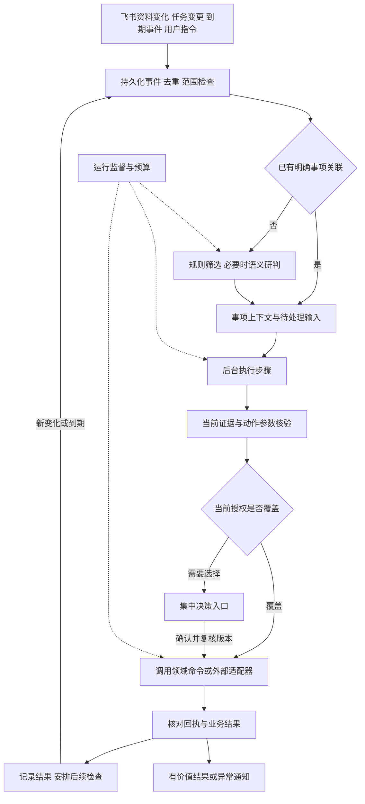

# 项目助理主动智能升级方案

日期：2026年11月3日。状态：P0 与 P1 首批本地能力已实现，工作区升级为 schema 14；下文仍包含后续设计，不代表全部交付。已实现范围、限制和验收记录见[首批实施说明](proactive-intelligence-implementation.md)。继续复用 Tauri、Rust、React、SQLite 架构。

目标是让助理持续关注项目目标，自动完成有依据的分析和准备，在已有授权范围内执行，并持续核实结果。用户得到的是值得处理的建议、需要拍板的选项和已核实的进展。衡量收益时同时计算事实准确性、主动发现率、用户注意力和模型成本。

优先完成“延期影响核查、到期跟进准备、资料冲突澄清”三个场景。第一阶段交付本地持续跟进；应用退出或电脑休眠期间暂停，重新运行后恢复。全天在线与跨设备执行属于后续部署能力。

## 参考方案与采用范围

DeepSeek 官方将 dsh-superagent-prototype 定位为研究参考，公开版与内部系统、设计文章存在差异，部分设计尚未实现。它面向单个 GitHub 仓库的编码工作，适合借鉴机制；本项目的执行对象是任务、依赖、风险、决策与跟进记录。[官方说明](https://github.com/deepseek-ai/dsh-superagent-prototype)

| 参考机制 | 本项目的采用方式 |
| --- | --- |
| Router 与 Worker 分工 | 前台统一接收指令和呈现结果；后台按事项维护独立上下文，调用现有业务能力。路由不承担长时间执行。[执行设计](https://github.com/deepseek-ai/dsh-superagent-prototype/blob/main/docs/003-execution.md) |
| 事件、事项订阅与后续信息直达 | 已明确关联的进展直接进入原事项，关联关系仅提供上下文，不能扩大动作授权。[领域模型](https://github.com/deepseek-ai/dsh-superagent-prototype/blob/main/docs/001-domain.md) |
| 短摘要和 ID 按需读取 | Router 只保留任务索引与待决策摘要；Worker 按当前问题读取证据。所有读取继续检查项目和版本。[实现架构](https://github.com/deepseek-ai/dsh-superagent-prototype/blob/main/docs/007-architecture.md) |
| 先观察主动行为，再扩大执行范围 | 新策略先回放并记录拟采取的行动；验证有用后，按场景开启自动准备或有限执行。[设计原则](https://github.com/deepseek-ai/dsh-superagent-prototype/blob/main/docs/000-philosophy.md) |
| 卡兹克的统一调度与决策反馈 | 复用事件去重、统一通知出口、明确决定后继续推进的做法。[同题文章全文](https://www.aitntnews.com/newDetail.html?newId=30834) |

下文是结合项目源码提出的实现设计。独立进展监督和未来的远程执行按本项目需求设计，不视为官方公开原型已经提供的产品能力。DeepSeek 的[设计文章原链接](https://zhuanlan.zhihu.com/p/2099987320443237060)可供延伸阅读；工程接口以上述官方仓库文档为依据。

## 当前基础与实际缺口

| 现有实现 | 继续复用 | 本次补齐 |
| --- | --- | --- |
| `lib.rs` 数据库 actor 与后台线程 | 单写者、短事务、工作区锁、恢复代次；模型和网络在事务外执行 | 业务变更与持久化事件原子保存、统一任务领取与恢复 |
| `proactive.rs` 主动行动 | 逾期、阻塞、依赖、里程碑巡检，行动去重和到期复查 | 从发现问题到分析、决策、执行、核实的运行记录 |
| `assistance.rs` 今日重点与帮我推进 | 有界证据包、引用匹配、任务关联、快照校验 | 逐事实语义审查、动作参数校验、持久化用量与执行提案 |
| `question_flow.rs` 等问答模块 | 固定义务、逐断言核验、未知保留、有限补查、快照复核 | 提取可复用的核验接口，供行动提案使用；避免对同一证据重复审查 |
| `memory_workbench.rs`、`governance.rs` | 偏好、纠错、质量标注、决策与版本历史 | 引用既有决定，补充适用范围、有效期及执行授权记录 |
| `feishu.rs` 与采集模块 | 来源绑定、增量采集、发送前校验、回执及结果未知保护 | 事项关联、决策卡片回调和统一外部动作适配器 |

最先修正的是建议入口的事实可信度。当前 `assistance.rs::checked_output` 验证引文确实存在，但没有证明分析、因果、联系人和沟通草稿中的每个事实都受引文支持。只有补上这层核验，建议才能作为执行提案。

现有质量基础也有实际限制：[最近一轮报告](memory-qa-structured-report.md)中，两个入口完整正确均为 16/19，记忆保留 17/19，QA 使用 299354 tokens；后两项未达到该轮门槛，100题未运行。这些是同模型评分的开发回归结果，不能当作中文项目行动准确率。

## 用户能够感知的变化

| 场景 | 助理自动准备的结果 | 需要决策的内容 | 后续核实 |
| --- | --- | --- | --- |
| 某项交付可能延期 | 原计划、最新承诺、已记录依赖、受影响里程碑和可选处理方案 | 是否调整计划、协调资源或对外承诺 | 到约定时间核对进展；发送成功和交付完成分别记录 |
| 等待回复或约定跟进日到达 | 查找相关新回复，整理尚缺的信息和跟进草稿 | 超出已配置规则的催办或升级处理 | 收到回复后更新待核事项，无新变化时遵守冷却时间 |
| 群聊与正式记录冲突 | 两种说法、作者、时间、适用条件和原文 | 哪个结论有效，是否修订正式记录 | 确认后重新分析受影响事项，撤下过期建议 |

延期示例：正式期限为周四，群里说“预计周五完成”。助理先保留两种时间的性质，核对该任务与测试里程碑的已记录依赖，再提出“核实能否拆分交付”等选项。若预计工作量、测试时间或负责人不明，只列缺项，不算出虚假的延期天数。用户确认调整后更新对应记录并设定复查；承诺不会直接变成完成。

首页沿用“今天、项目、资料”，集中呈现今天最值得处理的少量事项。每项展示发生了什么、为什么与你有关、已准备好什么、需要你选什么。正常后台处理折叠到历史；“无人回复”“正在等待承诺日期”和“执行失败”有不同状态。

## 整体运行流程

Router 是协调职责，首期用确定规则和小型有界模型调用实现。系统能够由项目 ID、对象 ID、事件类型确定去向时直接分派；模糊事项匹配和复杂影响分析才使用模型。各项目上下文独立，跨项目首页只汇总已获准展示的结果。

Worker 是可恢复的执行单元。首期提供影响分析、跟进准备、冲突澄清、结果核实四类能力，复用 Rust 业务接口。流程模板定义目标、输入、允许的命令、输出、完成条件和预算；提示词解释业务做法，程序执行范围和版本约束。

## 更智能的目标与上下文组织

每个事项保存目标、完成条件、当前已知事实、必要缺项、下一步、等待对象和下次检查时间。目标引用原任务或管理记录，目标改变时递增计划版本。系统以可观察的业务条件判断是否完成，例如“用户确认新交付安排并记录到任务”，而非把生成了一段回复算作完成。

关联优先级为明确任务 ID、引用的消息话题、来源绑定、已确认别名。模型只提出歧义关联候选；同名任务、模糊称谓及多个可能项目不能自动合并。一个聊天话题可以承载多个事项，同一事项也可以关联多个渠道；已终止的事项不会因普通聊天自动复活。

上下文分三种用途：

- 业务事实继续存于任务、正式记忆、管理记录及其修订；原文保留来源身份。未确认消息可触发核查，不能直接成为执行依据。
- 执行状态保存计划、步骤、事件读取位置、产物和等待条件。模型摘要和运行日志不进入正式事实库。
- 用户决定引用现有决策记录；授权另存动作、范围、条件、有效期和撤销关系。偏好影响表达，不能授权执行。

Router 的常驻内容只有目标索引、事项状态、关键变化及待决策摘要。详情通过“事件 → 事项 → 运行 → 决定 → 证据”稳定 ID 查回。摘要带原记录版本，失效时重新生成；链式读取必须逐次检查项目、当前修订、归档及权限。

“这次先不催”只约束这次事项；“本项目每个工作日最多跟进一次”才可能成为后续可执行规则。已明确、仍适用的决定自动复用；遇到前提改变时展示变化，不反复让用户重述背景。

## 更主动的发现与提前准备

事件进入后先用本地规则排除重复、无权限来源、助理自身回声、已终止事项及尚未到期的复查。原文仍按既有采集规则保存；被过滤的自动行为留下原因，供漏触发审计。相关性不确定的事件记录为待研判，不能用“过滤”掩盖模型失败。

同一事项短时间内的补充消息合并研判，撤销和纠正保留先后关系。用户停止或变更方向立即处理；同一事项只有一个有效运行代次。后续消息先记入输入，只有改变目标、已用事实、必要前提、动作参数或授权时才使旧提案失效；重复、无关消息和不改变前提的致谢不会取消待决策提案或触发重算。按事项订阅直达时仍重新检查动作授权。

自动准备包括查证进展、梳理依赖影响、整理会议材料、生成澄清问题、准备备选方案和沟通草稿。低成本、可复用的准备提前完成；没有新增依据、期限变化或重要状态变化时复用缓存，不周期性重写整个项目。

提醒与执行分开决定。优先考虑明确期限、依赖影响、用户关注程度及能否采取行动；严重性和证据充分性分别记录，避免把高影响但证据不足的判断显示为确定事实。普通事项合并到每日摘要，重要变化和必须选择的问题及时展示。已读、暂缓、忽略和通知去重跨重启保存。

同一事项只有新事实、重要程度变化、明确约定到期或用户要求时再次通知。没有收到进展意味着“需要核实”，不意味着实际延期。新规则先在观察模式记录拟采取的动作，经事件回放和小范围使用验证后再开启自动准备或既定范围内执行。

## 更精确的行动提案

行动输出采用可核验结构，UI 再将其组织成简短自然语言：

| 字段 | 约束 |
| --- | --- |
| `facts` | 每条断言绑定当前记录版本、原文片段及主体、角色、时间、条件 |
| `hypotheses` | 明确是推断，列依据和缺失前提，不能直接授权修改业务状态 |
| `unknowns` | 说明哪项缺失阻止哪个动作，优先查询已有记录后再向用户提问 |
| `options` | 可选动作及其影响；未给出估时或资源条件时不编造量化收益 |
| `proposedActions` | 白名单领域命令、明确对象、参数、预期版本、授权依据、预期结果 |
| `verification` | 执行后应读取什么来确认成功，以及何时需要再次核实 |

核验沿用已有问答能力，按动作所需的事实重新组织，避免每个 Worker 重跑一套完整问答：

1. 负责人、截止日期、状态等可直接读结构化字段的内容，由程序比较。
2. 对从自然语言归纳出的事实，复用逐断言审查，检查主体、角色、时间、否定、条件和因果。合法引用本身不等于语义正确。
3. 将事实与建议区分。建议日期不能冒充已批准排期；完成、交付、验收沿用各自业务条件。
4. 仅对阻止下一步的证据缺口做有界补查；找不到就保留未知，允许完成其他独立步骤。
5. 提交前重新核对依据版本、计划版本和目标状态。更新后的记录可能使先前正确的建议失效。
6. 执行后验证真实回执或领域记录。模型说“已完成”不能改变执行状态。

沟通草稿内的事实、联系人、日期、承诺和决定接受同样检查；语气润色不能引入新的承诺。相对日期锚定原事件发生时间与时区，保留原表达；时间不明确时不按处理当天猜测。依赖传播仅使用明确关系，名称相似和共同出现不能证明依赖或因果。

同模型复核是一层辅助，不能作为正确性的最终证明。业务约束由代码检查，模型判断的质量由人工标注的验收集衡量。多模型能力选择按同输入对照评估，首期不以品牌固定分工，也不靠多数模型同意判定事实。

## 授权与决策续跑

按项目和能力记录持续授权：允许自动准备、允许的具体领域动作、可用渠道、频次及成本范围。已有授权覆盖的操作持续执行；新范围或确需取舍时才出现决策项。读取项目资料与调用云模型继续遵守已有访问设置。

决策项展示变化前后、事实依据、推荐选项、其他选项及将产生的具体动作。授权绑定 `decisionId + planVersion + evidenceFingerprint + actionDigest`，同时保存生效范围和操作者。重复点击只应用一次；更改动作参数或关键依据后重新生成提案。资料没有实质变化时沿用有效决定。

提交时始终检查当前目标和关键依据版本。若仅有无关字段变化，由程序核对批准动作、关键事实及业务前提均相同后，记录重新绑定版本的审计并复用决定；不能凭模型一句“没有影响”绕过冲突。改变批准内容的提案需要新的决定。

等待用户或他人回复时释放运行槽，保留检查点。收到明确相关回复后恢复步骤，不从头重新分析。跨渠道用户身份通过认证账户及显式绑定确认；模型判断“这是同一个人”不能提供授权。

任务状态、排期、变更审批和验收仍由领域命令检查业务前提。外部沟通通过统一出口执行，核对准确的接收对象、正文和发送授权。飞书个人账号代答与新增决策卡片是不同能力；卡片需增加回调接入、操作者校验、过期处理和重复提交保护。飞书支持长连接回调，可在本地运行方式下进一步接入。[官方回调说明](https://open.feishu.cn/document/event-subscription-guide/callback-subscription/receive-and-handle-callbacks)

## 持久化与执行可靠性

新增状态在同一个工作区 SQLite 中迁移，并参与备份校验；运行不改变任务、记忆和管理记录的唯一事实来源。建议数据职责如下，具体表拆分随实施阶段确定：

| 记录 | 必要内容 |
| --- | --- |
| 事件与消费记录 | 来源事件 ID、来源版本、项目、对象、发生及接收时间、幂等键、原文引用、处理结果；为每个消费者记录接收状态 |
| 事项与订阅 | 业务目标、关联对象和渠道、后续输入位置、当前计划版本、等待条件、复查时间 |
| 运行与步骤 | 状态、执行器及规则版本、输入指纹、租约与 generation、检查点、产物、错误与可重试性 |
| 决策与授权 | 复用的业务决策引用、适用范围、依据版本、精确动作、有效期、撤销和替代关系 |
| 动作与通知回执 | 幂等键、意图、发送状态、外部回执、结果未知、通知原因及静默记录 |
| 预算与追踪 | 请求前预留、实际 usage、未知 usage、在途请求、各阶段耗时和结果；复用提取预算的高水位思路 |

本地业务变更和事件入队必须在同一事务内提交。现有命令名前缀巡检暂作补偿扫描。飞书连接器数据库与工作区数据库之间不能假设原子提交：连接器先保存输入，工作区按来源幂等键接纳，确认接纳后再推进投递状态，失败可重放。消息编辑使用来源版本区分，不把编辑后的新内容误当作原消息重复。

同一来源对象按可靠的来源版本及明确修订、替代关系判断新旧，接收时间不能决定事实优先级。较旧内容晚到时保留历史，不覆盖较新的更正。更正先到时记录其指向的旧对象及替代关系，旧对象之后到达也不能恢复已撤销提案；版本无法比较或更正对象不明确时保留双方，进入冲突核查。

运行状态采用 `queued → running → waiting_input / waiting_decision / verifying → succeeded`，另有 `paused / failed / cancelled`。等待恢复时进入新的执行代次。运行完成表示该轮目标已核实；业务任务完成仍取决于独立的业务状态和验收条件。

并发领取使用租约与递增代次，短事务完成；网络、模型与长时处理在 actor 外运行。旧代次返回结果不能提交。同一目标的写入检查版本；跨步骤通过依赖调度，互不依赖的只读工作可并行。保留用户主动请求的调度优先级，后台任务不能耗尽全部容量。

外部动作先提交持久化意图，再发送并记录回执。能由服务端幂等或查询回执确认的动作按协议恢复；发送超时、断网或崩溃后无法确认结果时标为 `unknown`，查询或人工核实后再决定。沿用飞书当前 `sending → unknown` 的保护，不能因租约到期盲目重发，也不声称整个系统具有严格一次执行保证。

备份恢复后暂停自动执行、外发和未完成决策，提升工作区代次并重新检查资料与授权。已发请求消耗和外部发送高水位保留在设备侧，不能通过旧备份回滚。归档、取消、解绑和授权撤销使相关在途写入失效，已发出的外部请求如实保留状态。

运行日志和完整模型输入设置有限保留期，结束运行的中间产物可按策略清理；仍被事实、决定或回执引用的依据保留。压缩记录保留关联 ID、版本、结果及费用，不把详细日志无限增长作为长期记忆方案。日志清理不能删除去重所需的外发记录或重置已消耗额度。

## 运行监督与成本

先由确定性监督检查租约、超时、重复步骤、连续相同错误及预算。实质进展以新证据、缺项解决、业务记录变化或有效产物衡量，重复输出文字不算进展。正常等待回复和未来复查属于等待状态。

规则无法判断是否跑偏时，才使用一次有预算的语义复核。监督可暂停、取消、安排有界重试或提出修复建议；不能自行扩大权限、修改用户目标、降低验收标准或重放结果未知的发送。首期监督运行在应用内，只能检查任务健康；进程退出后的恢复由下一次启动承担，后续需要常在线时再引入独立进程。

预算同时约束全局、项目、事项和阶段，记录 Router、Worker、审查、补查及监督的总成本。每次请求前预留；失败和在途请求也计入，提供方未报告 usage 时保留未知并保守计提。缓存命中单列，不能记为一次新的成功模型请求。货币估算与实际 token 用量分别展示。

初始运行参数建议为两个后台只读执行槽、同一事项一个活动代次、单轮语义研判一次、补查一轮、监督复核一次。沿用各能力已有请求/超时上限，并增加共同的运行预算，不能把每个子步骤的独立上限相加为无限额度。具体 token 额度通过首期业务回放确定并在启用策略前固定。

零模型规则判断、缓存、事项直达和批量研判优先用于减少成本。额度不足时保留本地到期检查和已知事实，明确记录分析暂停，避免默默丢失工作。

## 分阶段实施

| 阶段 | 交付内容 | 主要入口 | 进入下一阶段的条件 |
| --- | --- | --- | --- |
| P0 行动精确性 | 结构化提案、建议与草稿事实审查、共享语义核验接口、assistance 持久化追踪 | `assistance.rs`、`question_flow.rs`、`answer_contract.rs`、`evidence_pack.rs` | 动作参数与断言测试通过；人工核定回放中关键事实无错误；成本可见 |
| P1 本地持续推进 | 事务事件、事项与步骤、决定后续跑、到期核实、暂停和恢复；同一事项决定持久化、复用、撤销及重复点击保护，打通三个首期场景 | `lib.rs`、`db.rs`、`proactive.rs`、`delivery.rs`、`governance.rs`、`backup.rs`；新增 orchestration 模块 | 重复、乱序、重启、过期决定及回滚用例通过；观察模式达到行动质量门槛 |
| P2 飞书交互与授权执行 | 卡片决策、回执查询、现有个人代答与新动作统一记账、低噪声通知 | `feishu.rs`、采集模块、主动行动及今日界面 | 在授权测试会话联调；操作者与范围正确；发送结果未知不误报、不重发 |
| P3 策略优化与部署扩展 | 经用户明确确认的跨事项策略复用、反馈调整排序、模型路由对照；必要时增加后台服务或远程执行 | 策略模块、质量标注、运行追踪与桌面 runtime | 业务收益明确，满足成本和隐私约束；单独验收在线性与设备断连恢复 |

P0、P1优先，构成可验证的产品增量。首批已实现建议与草稿核验、持久化分析用量，以及三个场景的本地规则准备、明确决定、复查和恢复。`get_assistant_work`、`get_action_proposal`、`decide_action_proposal`、`pause_assistant_work` 等接口已经落地，详见[应用契约](contract.md)。通用模型 Worker、消息语义关联、跨事项授权策略、完整事件回放和外部动作仍属于后续范围；当前不直接执行模型生成的命令名。

## 验收与收益判断

复用现有公开问答集作为回归。新增中文项目事件流，覆盖承诺、撤回、纠正、角色混淆、时间歧义、重复、乱序、沉默和执行中变更。合成数据验证机制；业务效果使用经允许的脱敏真实样本，由人工标注每个时点是否该行动、作用对象、所需证据、通知必要性和正确下一步。

按项目和时间段隔离开发与冻结验收集，同一事项的前后消息不能跨集合泄漏。验收集在调参前冻结，出现失败后保留原分；用来修正系统的样本转为开发回归，另补未见样本。模型评分只作辅助，关键错误和分歧人工复核。

以下为拟定放行门槛，不是已达到的结果。冻结验收至少包含30个应行动事项和30个无需行动事项，另有故障注入用例；同时报告原始分子分母和样本不确定性，不能以小样本零错误承诺绝对可靠。

计分按人工标注的“事项、有效时间段、必要动作”一对一匹配；可接受的替代动作预先列明。拆分或重复提案不能重复获得正确命中，额外且无必要的提案计为误触发。新的实质变化另行标注，模型内部修订不重复记为用户收到的行动；另报全部被核验拦截的错误和重复通知次数。

| 维度 | 拟定门槛或检查方法 |
| --- | --- |
| 行动精确性 | 系统实际提出的行动中，确有必要且主体、动作与依据整体正确的比例至少90%；分母包括多余、错误及重复行动。关键负责人、日期、完成状态错误为0 |
| 主动发现 | 人工标注的应行动事项中，在标注的有效时间内正确发现并提出相应行动的比例至少85%；未能处理、歧义和预算暂停计入漏处理诊断 |
| 事实支持 | 提案事实断言得到当前证据支持的比例至少95%；未经支持的事实不得进入执行参数 |
| 隔离与执行 | 测试中跨项目引用、重复执行、过期决定写入、未满足业务前提的状态修改均为0 |
| 持续推进 | 每个已确认决定都能续跑或显示具体阻塞；重启后无遗漏；发送未知不能显示完成 |
| 注意力 | 无变化且未到约定复查时间的测试流无重复通知；真实试用记录有用通知比例、忽略原因和人工处理耗时 |
| 时效 | 分别统计来源采集延迟、事件接纳后调度延迟、模型耗时、人工等待和结果核实的P50/P95；不把飞书索引延迟算成推理延迟 |
| 成本收益 | 对相同事件流和同等合格产出，与现有手动触发流程配对，统计每个有效行动总tokens与请求数；初期目标总tokens不超过基线1.2倍，并减少至少30%人工操作步骤；无基线时先测量 |

在隔离环境中按“只加事件调度、再加事实审查、再加有限执行”设置离线回放组，分别观察发现率、准确率、成本和人工步骤。该顺序用于消融对照；产品放行仍按 P0 → P1 → P2，未经事实审查的组不执行真实业务动作。所有失败、重试、审查和监督调用计入开销，不能只统计成功请求。早期只达到自动准备门槛的场景保持准备模式，范围扩大以对应场景的验收结果为依据。

必要故障用例包括：同一消息重复投递；来源消息被编辑；纠正先于原消息到达；同名任务跨项目；审批期间任务改版；同意后应用退出；本地写入成功但回执丢失；外发中崩溃；预算耗尽；恢复旧备份；用户暂停后迟到结果；待回复期间被监督误重跑。静默过滤、主动采纳和模型失败均必须可追踪。
